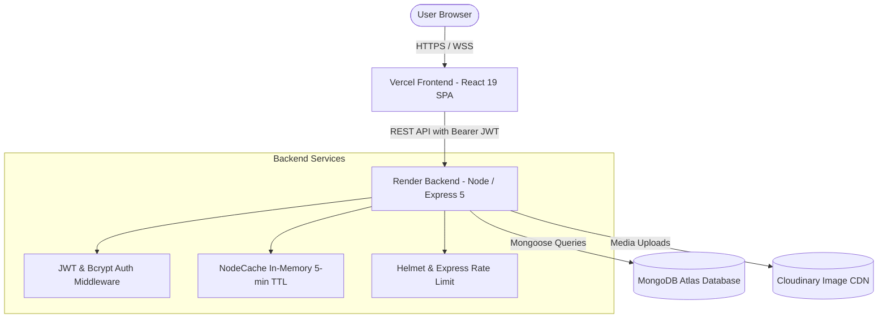

# 🌌 CyberLib — Next-Gen Cyberpunk Book Discovery & Recommendation Platform

[](https://nodejs.org/)
[](https://expressjs.com/)
[](https://react.dev/)
[](https://www.mongodb.com/atlas)
[](https://cloudinary.com/)
[](https://render.com/)
[](https://vercel.com/)
[](https://opensource.org/licenses/ISC)

> **CyberLib** is a full-stack, cyberpunk-themed web application engineered for intelligent book discovery, personalized genre recommendations, community reviews, and conversational AI book guidance.

---

## 📑 Table of Contents

- [Features](#-features)
- [System Architecture](#-system-architecture)
- [Tech Stack](#-tech-stack)
- [Repository Structure](#-repository-structure)
- [API Reference](#-api-reference)
- [Getting Started Locally](#-getting-started-locally)
  - [Prerequisites](#prerequisites)
  - [1. Clone Repository](#1-clone-repository)
  - [2. Backend Setup](#2-backend-setup)
  - [3. Frontend Setup](#3-frontend-setup)
- [Production Deployment Guide](#-production-deployment-guide)
  - [Deploying Backend to Render](#deploying-backend-to-render)
  - [Deploying Frontend to Vercel](#deploying-frontend-to-vercel)
  - [Configuring Production CORS](#configuring-production-cors)
- [Security & Performance Optimizations](#-security--performance-optimizations)
- [License](#-license)

---

## ✨ Features

### 🎯 Personalized Book Recommendations
- **Cold-Start Genre Onboarding**: New users select at least 3 favorite genres from a neon genre picker.
- **Dynamic Recommendation Carousel**: Aggregates and surfaces books aligned with user interests, rotating batches to prevent content exhaustion.

### 🔍 Unified Search & Discovery
- **Multi-Entity Search**: Instant simultaneous regex query across book titles, author names, genres, and works.
- **Paginated Results**: Optimized with `page` and `limit` query parameters with complete metadata (`totalBooks`, `totalPages`).

### 🤖 Cyberpunk AI Chatbot
- **Intelligent Queries**: Suggests books by genre, author lookups, and similar books based on contextual inputs.
- **Persistent Chat History**: Stores user conversations with synchronous `useRef` session deduplication.
- **Date Grouping**: Displays conversations organized into **Today**, **Yesterday**, **Previous 7 Days**, and **Older** with clean timestamps and sanitized preview snippets.

### 📚 Personal Library Management
- **Read List & Wishlist**: One-click toggling for tracking books read and books to read.
- **Live Popular Counters**: Real-time atomic increment/decrement of community read and wishlist counters.

### ⭐ Social Ratings & Reviews
- **Community Feedback**: Submit 1–5 star ratings and reviews for books and authors.
- **Weighted Scoring**: Automatically recalculates and saves running average ratings upon submission.

### 👤 Profile & Cloud Avatar Uploads
- **Resilient Upload Pipeline**: Multer buffers images locally and streams to **Cloudinary** for persistent CDN delivery.
- **Graceful Fallback**: If cloud credentials fail or disconnect, automatically falls back to local disk storage (`/uploads/`) without throwing 400/500 errors.

---

## 🏛️ System Architecture



---

## 🛠️ Tech Stack

| Domain | Technology | Version | Purpose |
|---|---|---|---|
| **Frontend** | React | `v19.1.0` | Declarative component UI |
| **Frontend** | React Router DOM | `v7.5.1` | Client-side routing with SPA rewrites |
| **Frontend** | Axios | `v1.8.4` | HTTP client with automatic 401 token cleanup interceptor |
| **Backend** | Node.js | `v20+` / `v22` | Server runtime with `--watch` hot-reload support |
| **Backend** | Express.js | `v5.1.0` | REST API routing and middleware chain |
| **Database** | MongoDB Atlas | `v8.13.2` | Cloud document database via Mongoose ODM |
| **Security** | Helmet | `v8.1.0` | HTTP security headers and CORP policy |
| **Security** | Express Rate Limit | `v7.5.0` | API rate limiting (300 requests / 15 minutes) |
| **Security** | JSON Web Tokens | `v9.0.2` | 64-byte signed stateless Bearer authentication |
| **Security** | BcryptJS | `v3.0.2` | Adaptive salt password hashing |
| **Caching** | Node-Cache | `v5.1.2` | In-memory response caching for aggregations |
| **Media** | Cloudinary & Multer | `v1.41.3` | Multipart profile photo parsing & cloud CDN hosting |
| **DevOps** | Render | Cloud | Managed Web Service for Node backend |
| **DevOps** | Vercel | Cloud | Edge network deployment for React SPA |

---

## 📁 Repository Structure

```text
CyberLib/
├── backend/
│   ├── controllers/
│   │   ├── authController.js           # Signup, login, JWT token issuance
│   │   ├── authorController.js         # Author details and reviews
│   │   ├── bookController.js           # Paginated search & personalized recommendations
│   │   ├── chatController.js           # Chat persistence and message history
│   │   ├── chatbotController.js        # Chatbot recommendation matching logic
│   │   ├── popularauthorsController.js # Aggregated top authors with caching
│   │   ├── popularbooksController.js   # Top books counter with cache invalidation
│   │   ├── profileController.js        # User profile & Cloudinary resilient uploads
│   │   ├── userController.js           # User interest preferences
│   │   └── userbooksController.js      # Read list and wishlist CRUD operations
│   ├── middleware/
│   │   └── auth.js                     # JWT verification & socket retry handler
│   ├── models/
│   │   ├── author.js                   # Author schema & compound text indexes
│   │   ├── book.js                     # Book schema, compound text & rating indexes
│   │   ├── chat.js                     # Chat document & compound date index
│   │   ├── popularBooks.js             # Popular counters with unique book index
│   │   └── user.js                     # User schema with interests, library, and mixed image
│   ├── routes/                         # Express API route modules
│   ├── uploads/                        # Static fallback upload storage
│   ├── .env.example                    # Backend environment template
│   ├── package.json                    # Backend scripts ('start', 'dev' with --watch)
│   └── server.js                       # Express bootstrap, CORS, helmet & health checks
├── frontend/
│   ├── public/                         # Public assets & index.html
│   ├── src/
│   │   ├── components/                 # Navbar, SearchBar, ChatHistory, AuthForm, etc.
│   │   ├── pages/                      # Dashboard, BookDetails, AuthorDetails, UserProfile, etc.
│   │   ├── apiClient.js                # Central Axios client with token & 401 interceptors
│   │   ├── App.jsx                     # Route declarations
│   │   └── index.css                   # Global cyberpunk color tokens & styles
│   ├── .env.example                    # Frontend environment template
│   ├── package.json                    # Frontend scripts
│   └── vercel.json                     # Client-side SPA routing rewrites
├── render.yaml                         # Automated Render web service blueprint
├── vercel.json                         # Root Vercel monorepo configuration
├── .gitignore                          # Git tracking exclusions
└── README.md                           # Documentation
```

---

## 🔌 API Reference

### 1. Authentication (`/api/auth`)
| Method | Endpoint | Access | Description |
|---|---|---|---|
| `POST` | `/api/auth/signup` | Public | Register new user account |
| `POST` | `/api/auth/login` | Public | Authenticate user and return JWT |

### 2. Books & Discovery (`/api/books`)
| Method | Endpoint | Access | Description |
|---|---|---|---|
| `GET` | `/api/books/search?q=:query&page=:p&limit=:l` | Public | Paginated unified book and author search |
| `GET` | `/api/books/recommendations` | Private | Personalized books based on user interests |
| `GET` | `/api/books/:id` | Public | Get single book details |
| `POST` | `/api/books/review/:id` | Private | Submit 1–5 star rating & review for a book |

### 3. Popular Rankings (`/api/popular-books`, `/api/popular-authors`)
| Method | Endpoint | Access | Description |
|---|---|---|---|
| `GET` | `/api/popular-books` | Public | Cached top 5 books by read & wish count |
| `POST` | `/api/popular-books/read/:bookId` | Public | Increment book read counter |
| `POST` | `/api/popular-books/wishlist/:bookId` | Public | Increment book wishlist counter |
| `POST` | `/api/popular-books/remove-read/:bookId` | Public | Decrement book read counter |
| `POST` | `/api/popular-books/remove-wishlist/:bookId` | Public | Decrement book wishlist counter |
| `GET` | `/api/popular-authors` | Public | Cached top 5 rated authors |

### 4. User Library & Profile (`/api/user`)
| Method | Endpoint | Access | Description |
|---|---|---|---|
| `GET` | `/api/user/books/read` | Private | Retrieve user's completed books |
| `POST` | `/api/user/books/read` | Private | Add book to personal read list |
| `DELETE`| `/api/user/books/read/:bookId` | Private | Remove book from personal read list |
| `GET` | `/api/user/books/wishlist` | Private | Retrieve user's wishlist |
| `POST` | `/api/user/books/wishlist` | Private | Add book to personal wishlist |
| `DELETE`| `/api/user/books/wishlist/:bookId` | Private | Remove book from personal wishlist |
| `GET` | `/api/profile` | Private | Retrieve profile stats & avatar |
| `POST` | `/api/profile/upload` | Private | Upload avatar image (Cloudinary / Local) |
| `POST` | `/api/user/update-interests` | Private | Update favorite genres |

### 5. AI Chat & History (`/api/chat`, `/api`)
| Method | Endpoint | Access | Description |
|---|---|---|---|
| `GET` | `/api/chat` | Private | Fetch user chat history |
| `POST` | `/api/chat` | Private | Create or append messages to conversation |
| `GET` | `/api/chatbot/recommendations?genre=:g` | Public | Match books by genre query |
| `GET` | `/api/chatbot/author?author=:a` | Public | Match books by author query |
| `GET` | `/api/chatbot/similar-books?title=:t` | Public | Suggest books with matching genre |

### 6. Health & Monitoring
| Method | Endpoint | Access | Description |
|---|---|---|---|
| `GET` | `/health` | Public | Healthcheck endpoint reporting status and uptime |
| `GET` | `/` | Public | Root heartbeat status message |

---

## 🚀 Getting Started Locally

### Prerequisites
- [Node.js](https://nodejs.org/) (version 18+ or 20+ recommended)
- [npm](https://www.npmjs.com/)
- A free [MongoDB Atlas](https://www.mongodb.com/atlas) cluster or local MongoDB instance
- A free [Cloudinary](https://cloudinary.com/) account (for persistent avatar uploads)

---

### 1. Clone Repository

```bash
git clone https://github.com/muahmad232/CyberLib.git
cd CyberLib
```

---

### 2. Backend Setup

1. Navigate to the backend directory:
   ```bash
   cd backend
   ```

2. Install dependencies:
   ```bash
   npm install
   ```

3. Create your `.env` configuration:
   ```bash
   cp .env.example .env
   ```

4. Populate `backend/.env`:
   ```env
   # MongoDB Atlas Connection
   MONGO_URI=mongodb+srv://<username>:<password>@cluster0.mongodb.net/library?retryWrites=true&w=majority

   # Cryptographically secure 64-byte random hex string
   JWT_SECRET=your_super_secret_64_byte_random_hex_key

   # Local server port
   PORT=5000

   # Allowed frontend origins (comma-separated)
   FRONTEND_URL=http://localhost:3000

   # Cloudinary Credentials (from Cloudinary Dashboard)
   CLOUDINARY_CLOUD_NAME=your_cloud_name
   CLOUDINARY_API_KEY=your_api_key
   CLOUDINARY_API_SECRET=your_api_secret
   ```

5. Launch the backend server with auto-reloading:
   ```bash
   npm run dev
   ```
   *The server will start on `http://localhost:5000`.*

---

### 3. Frontend Setup

1. Open a new terminal and navigate to the frontend directory:
   ```bash
   cd frontend
   ```

2. Install dependencies:
   ```bash
   npm install
   ```

3. Configure environment variables (optional locally since proxy defaults to `http://localhost:5000`):
   ```bash
   cp .env.example .env
   ```
   Ensure `REACT_APP_API_URL=http://localhost:5000`.

4. Start the frontend development server:
   ```bash
   npm start
   ```
   *Your browser will automatically open `http://localhost:3000`.*

---

## 🌐 Production Deployment Guide

### Deploying Backend to Render

1. Log in to [Render Dashboard](https://dashboard.render.com/) and click **New +** → **Web Service**.
2. Select your repository `CyberLib`.
3. Fill in the configuration:
   - **Name**: `cyberlib-backend`
   - **Root Directory**: `backend` *(Do not leave blank)*
   - **Runtime**: `Node`
   - **Build Command**: `npm install`
   - **Start Command**: `node server.js`
   - **Plan**: `Free`
4. Under **Environment Variables**, add:
   - `MONGO_URI`: Your MongoDB Atlas connection URI
   - `JWT_SECRET`: 64-byte secure key
   - `CLOUDINARY_CLOUD_NAME`: Your Cloudinary Cloud Name
   - `CLOUDINARY_API_KEY`: Your Cloudinary API Key
   - `CLOUDINARY_API_SECRET`: Your Cloudinary API Secret
   - `FRONTEND_URL`: `http://localhost:3000` *(Update in step 3 below)*
   *(Note: Do not add `PORT`; Render assigns this automatically).*
5. Click **Deploy Web Service**.
6. Once active, note your live backend URL (e.g., `https://cyberlib-backend.onrender.com`). Verify via `/health`.

---

### Deploying Frontend to Vercel

1. Log in to [Vercel](https://vercel.com/) and click **Add New…** → **Project**.
2. Import the `CyberLib` repository.
3. Configure the build:
   - **Framework Preset**: `Create React App`
   - **Root Directory**: Click **Edit** → select `frontend` → click **Continue**
4. Under **Environment Variables**, add:
   - `REACT_APP_API_URL`: `https://cyberlib-backend.onrender.com` *(Your Render URL with NO trailing slash)*
5. Click **Deploy**.
6. Vercel will build and provide your production link (e.g., `https://cyberlib.vercel.app`).

---

### Configuring Production CORS

1. Go back to Render → select `cyberlib-backend` → **Environment**.
2. Update `FRONTEND_URL` with your live Vercel domain:
   ```text
   https://cyberlib.vercel.app,http://localhost:3000
   ```
3. Save changes. Render will automatically re-deploy with CORS enabled for your live site.

---

## 🛡️ Security & Performance Optimizations

- **Cryptographic JWTs**: Signed with a 64-byte secure key with automatic 401 response interceptor clearing stale tokens.
- **Index Optimization**:
  - Compound text search index on `{ title: 'text', authors: 'text', description: 'text' }`.
  - B-tree sorting indexes on `{ rating: -1, reviewCount: -1 }` and `{ readCount: -1, wishCount: -1 }`.
  - Compound history index on `{ userId: 1, createdAt: -1 }`.
- **In-Memory Caching (`node-cache`)**:
  - 5-minute TTL caching on heavy aggregations (`/api/popular-books` and `/api/popular-authors`).
  - Active cache invalidation upon any review submission or count change.
- **Resilient Media Storage**:
  - Direct Cloudinary CDN streaming with automatic fallback to local storage if third-party credentials or connections fail.
- **DDoS & Header Protection**:
  - Rate limited to 300 requests per 15 minutes per IP.
  - Helmet headers enabled with cross-origin resource policy compliance.

---

## 📄 License

This project is licensed under the [ISC License](LICENSE).
